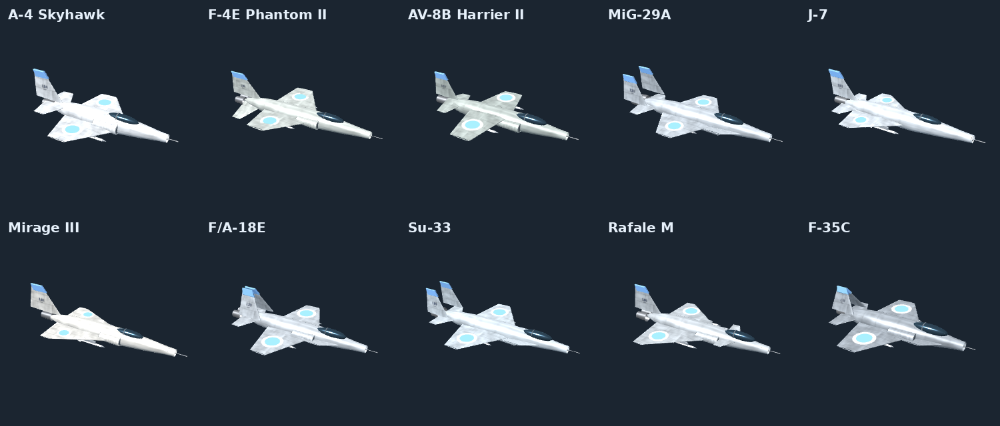

# 3D-модели самолётов Carrier Strike

10 самолётов из игры, выгружены напрямую из её 3D-моделей.

| Файл | Самолёт | Длина |
|---|---|---|
| `a4` | A-4 Skyhawk | 12 м |
| `f4e` | F-4E Фантом II | 19 м |
| `av8b` | AV-8B Харриер II | 14 м |
| `mig29` | МиГ-29А | 17 м |
| `j7` | J-7 | 13,5 м |
| `mir` | Мираж III | 15 м |
| `fa18` | F/A-18E Супер Хорнет | 18,3 м |
| `su33` | Су-33 | 21,2 м |
| `rafale` | Рафаль M | 15,3 м |
| `f35c` | F-35C | 15,7 м |

- **`.glb`** — с цветами, текстурой обшивки, номером на киле и знаками. Лучший вариант.
- **`.obj`** — только форма, без цветов (для программ, которые не открывают .glb).
- Около 2 500–3 500 треугольников в каждой модели (лимит Roblox — 20 000).
- Размеры в метрах, нос смотрит в сторону −Z, верх — +Y. Шасси убраны.
- `carrier-strike-planes.zip` — все файлы одним архивом.

## Как загрузить в Roblox Studio
1. Roblox Studio → вкладка **Home** (или **Model**) → **Import 3D**.
2. Выберите файл `.glb` (например `su33.glb`).
3. В окне импорта: **Scale** — поставьте около **3.5** (1 stud ≈ 0,28 м), оставьте включёнными **Import Textures / Materials**.
4. Нажмите **Import** — самолёт появится в Workspace как модель.
